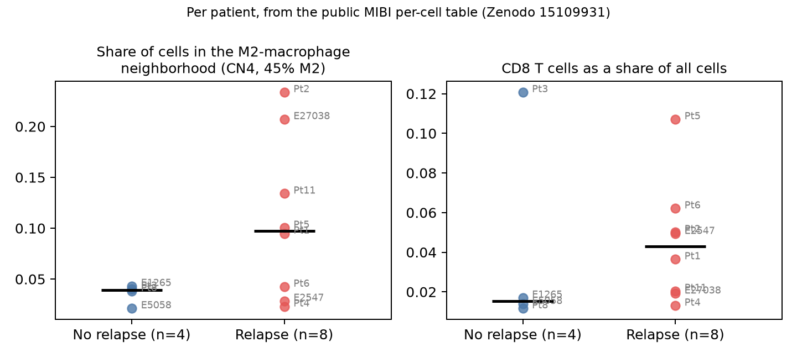

# Reproducing the PDAC neighborhood analysis from public MIBI data

A small, honest attempt to reproduce the main claims of:

> Yeung J, Bai Y, … Sivakumar S, Jiang S. *Spatial Proteomics Uncovers Immune Cell
> Neighborhoods and Tumor-Immune Interfaces in Pancreatic Ductal Adenocarcinoma.*
> Mol Cell Proteomics, 2026. PMID 42946214. doi:10.1016/j.mcpro.2026.101697

using only the per-cell table the lab published on Zenodo
([record 15109931](https://zenodo.org/records/15109931),
`All_anno_Tumor distance-inf_0328.csv`, CC BY 4.0).

## Data

The table has 854,287 segmented cells from 12 patients (8 relapsed, 4 not), with 3–4 images
each. For every cell it gives an X/Y position, 27 marker intensities, a cell-type
label (`cell_cluster`), the patient, relapse status and distance to tumour. After
dropping cells labelled `Junk`, 847,234 cells and 16 cell types remain.

## Method (simpler than the paper's)

1. For each cell, take a **window of its 10 nearest cells** in the same image. Count the
   cell types in that window. The result is one row of 16 counts per cell.
2. Fit **LDA with 8 topics** on those count rows. Each cell's neighborhood (CN) is its
   most likely topic. This is the idea behind the paper's *spatial* topic model,
   but without the spatial smoothing.
3. Repeat step 2 with **k-means (8 clusters)** to check the result does not depend on LDA.
4. For each patient, compute the share of cells in each CN. Compare relapsed with
   non-relapsed patients using a Mann–Whitney U test.

## What came out

| Paper's claim (abstract) | This reproduction |
|---|---|
| An immunosuppressive neighborhood is enriched in relapsed patients | **Same direction.** An M2-macrophage neighborhood (about 45% M2) was 2.5× more common in relapsed patients (median 9.8% vs 3.9% of cells). It was higher in 78% of relapsed/non-relapsed pairs. 3 of 5 LDA seeds produce a distinct M2 topic, and all 3 give this result. The other 2 merge M2 into a broad stromal topic, and the effect weakens. k-means agrees in direction. **Not significant** (p≈0.11–0.15, n=8 vs 4). |
| Immunosuppressive myeloid cells are enriched in relapse | **Split.** M2 macrophages are higher in relapse. Neutrophils are *lower*: 9% vs 37% of immune cells, at the median. |
| Cytotoxic CD8 T cells are depleted in relapse-prone tumours | **Opposite direction here.** CD8 cells are 4.3% of all cells in relapsed patients and 1.5% in non-relapsed, at the median. This holds as a share of immune cells and per tumour cell too. Only one non-relapsed patient (Pt3) has high CD8. **Open question:** the paper likely uses a different definition or normalisation (for example, functional cytotoxic markers). |



## Caveats

- 12 patients. No p-value here survives as evidence. Read the results as direction only.
- The two cohorts (`E…` and `Pt…`) differ in their relapse balance (E: 2/2, Pt: 6/2), so cohort could confound the results.
- Labels are the lab's `cell_cluster` annotations. The `Other` label covers 36% of cells.
- No access to the paper's full methods. The comparison is against the abstract only.

## Run

```bash
uv venv --python 3.12 .venv && uv pip install --python .venv/bin/python pandas numpy scipy scikit-learn matplotlib
.venv/bin/python 01_explore.py   path/to/cells.csv
.venv/bin/python 02_reproduce.py path/to/cells.csv   # writes per_patient.csv, cn_composition.csv
.venv/bin/python 03_checks.py    path/to/cells.csv   # CD8 normalisations, LDA seed stability
.venv/bin/python 04_figure.py                        # writes findings.png
```
